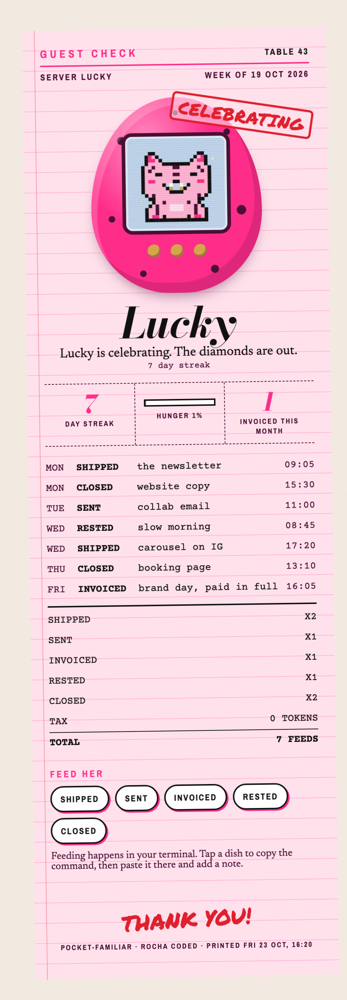

# pocket-familiar

*Free tools from the Rocheverse.* Part of **Rocha Coded**.



## What she gets you

A pixel familiar who lives at the bottom of your Claude Code window.
Lucky is a pink leopard with a diamond grill.
She eats what you ship: a post, an email, an invoice, a rest day, a closed item.
She gets worried when something you shipped breaks.
She gets sleepy when you have been at it too long.
Every week she prints you a guest check of everything you fed her.

## Why she eats actions, not tokens

When Claude Code shipped its own little buddy, a wave of terminal pets followed. Every one of them eats tokens or commits, so they grow fat on busywork and reward you for keeping the machine running. Lucky is a founder's familiar, not a developer's. She only eats the things that move a business: the newsletter that went out, the pitch you sent, the invoice, the item you finally closed, and the rest day you took on purpose. Rest counts as food. The tax line on her receipt always reads 0 tokens.

## Install

You need Python 3.10 or newer. Nothing else.

| Where you use her | Install | What you get |
|---|---|---|
| [Claude Code](#claude-code) (recommended) | clone into `~/.claude/skills`, run `install.sh` | status line, session hooks, the `familiar` command, the web card |
| [Any terminal](#any-terminal) | clone anywhere, run `install.sh --cli-only` | the `familiar` command and the web card |
| [Claude Cowork](#claude-cowork) | upload `pocket-familiar.zip` as a skill | Claude feeds her for you and prints her card |

The status line and the hooks are Claude Code only. Everything else works anywhere with a terminal.

### Claude Code
```sh
git clone https://github.com/RochaStone/pocket-familiar ~/.claude/skills/pocket-familiar
bash ~/.claude/skills/pocket-familiar/install.sh
familiar hatch
```
Restart Claude Code. She is at the bottom of the window.
The installer backs up your `~/.claude/settings.json` before it touches anything, keeps your other hooks, and saves your old status line so it can come back.
To undo: `bash ~/.claude/skills/pocket-familiar/uninstall.sh`.

### Any terminal
```sh
git clone https://github.com/RochaStone/pocket-familiar ~/pocket-familiar
bash ~/pocket-familiar/install.sh --cli-only
familiar hatch
```

### Claude Cowork
1. Download `pocket-familiar.zip` from the latest release.
2. In the Claude desktop app: Customize > Skills, then + > Create skill > Upload a skill, and pick the zip.
3. Give your Cowork task a folder to keep her in, then say: "Hatch my pocket familiar."
4. From then on, tell Claude what you did. "I shipped the newsletter." Claude feeds her.

## The five feeds

```sh
familiar feed shipped "the newsletter"
familiar feed sent "podcast pitch"
familiar feed invoiced "brand day"
familiar feed rested "beach, phone off"
familiar feed closed "booking page"
```

Or just tell Claude. "Invoice is out." Claude feeds her and tells you so.

## Her moods

Exactly one mood wins. She checks them in this order.

| Mood | Sprite | When |
|---|---|---|
| asleep | `∴(=_✧_=)zZ` | quiet hours (23:00 to 07:00 unless you change it) |
| worried | `∴(=ﾟ✧ﾟ;=)∴` | a probe in your ledger is failing |
| celebrating | `✧\(=^✧^=)/✧` | for an hour after you ship or invoice, or hit a 3, 7 or 21 day streak |
| sleepy | `∴(=-✧-=)ᶻ` | your Claude Code session has run past 3 hours |
| restless | `≋(=･✧･=)≋` | open items are past their default date |
| hungry | `∴(=°✧°=)っ` | nothing fed for 24 hours |
| fed | `∴(=^･✧･^=)∴` | all good |

The ✧ is her grill. The ∴ are her spots.

## Make her yours

```sh
familiar config --name Diamond          # rename her
familiar config --watch invoiced        # the one number on her card
familiar config --quiet 22:30-06:30     # her bedtime, or off
familiar config --hunger-hours 36       # how long she can wait
familiar config --ledger ~/probes/ledger.json   # a ledger somewhere else (goal tests is found on its own)
familiar config --open-items ~/notes/OPEN_ITEMS.md # she gets restless when a default is due
```

If you use goal tests from Claude Code for Founders, she finds its ledger on her own (`$GOAL_TESTS_HOME/ledger.json`, then `~/.claude/goal-tests/ledger.json`). She is worried for as long as its `failing` list has a name in it.
No ledger means no worry. A ledger older than 26 hours means the daily sweep has not run, so she does not worry about it either. `familiar config --ledger off` turns this off.
Any other JSON with pass and fail statuses works too (see `examples/ledger.example.json`), and so does a plain log with `PASS name` and `FAIL name` lines.
An open item is a markdown table row or a `- [ ]` line with a date in it. Struck-through or ticked rows are skipped. See `examples/open-items.example.md`.

## Make it yours

Her colours, fonts and lines come from one `style.json`, and the same file styles every Rocha Coded tool.
Two come in the box: `examples/style.rocha-coded.json` (Rocha's look, the pink you see above) and `style.example.json` (blank, for yours). `STYLE.md` explains every key.
Put yours in your working folder or in `~/.rocha-coded/style.json`, or ask Claude to make one with you from a few references.

## See her

- `familiar status` tells you how she is and why.
- `familiar card` prints this week as a guest check, right in the terminal.
- `familiar web` opens her web card. Tap a dish to copy the feed command. Feeding happens in your terminal.

## What's inside

| File | What it does |
|---|---|
| `familiar` | the command (one Python file, standard library only) |
| `mood.py` | the mood rules, documented at the top |
| `statusline.sh` | the Claude Code status line |
| `hooks/` | session start greeting, session length tracking |
| `templates/familiar.html` | the web card, one self-contained page |
| `style.py`, `STYLE.md`, `style.example.json` | the shared style file: lookup, keys, a blank one to fill in |
| `install.sh`, `uninstall.sh` | safe setup and a clean undo |
| `SKILL.md` | tells Claude how to install, feed and read her |
| `examples/` | the card above, Rocha's style, a sample week, sample ledger and open items |
| `tests/` | `python3 -m unittest discover -s tests` and `bash tests/test_statusline.sh` |

Her memories live in `~/.familiar` on your computer. Nothing is sent anywhere.

Not affiliated with any other terminal pet or familiar project.

## Licence

MIT. See [LICENSE](LICENSE).

## Made by Rocha

Rocha \
Brand Alchemist & AI Architect \
Author of *Brand Alchemy in the Thriving Era* \
Creator of [Conscious Founder OS](https://founders.thrivingera.com) \
Founder, [Thriving Era Studio](https://thrivingera.com)

I take female founders AI native in 7 days, and I build what they need next. \
Start with the audit: [thrivingera.com/audit](https://thrivingera.com/audit). \
Or book an exploratory call: [calendly.com/rochelle-thrivingera/exploratory-call](https://calendly.com/rochelle-thrivingera/exploratory-call). It is where we decide if we work together.

[Instagram @rocheverse](https://instagram.com/rocheverse) · [Substack](https://rochastone.substack.com) · [LinkedIn](https://www.linkedin.com/in/rochellelivingstonecosmic) · [More free tools](https://thrivingera.com/free) · [All tools on GitHub](https://github.com/RochaStone)
